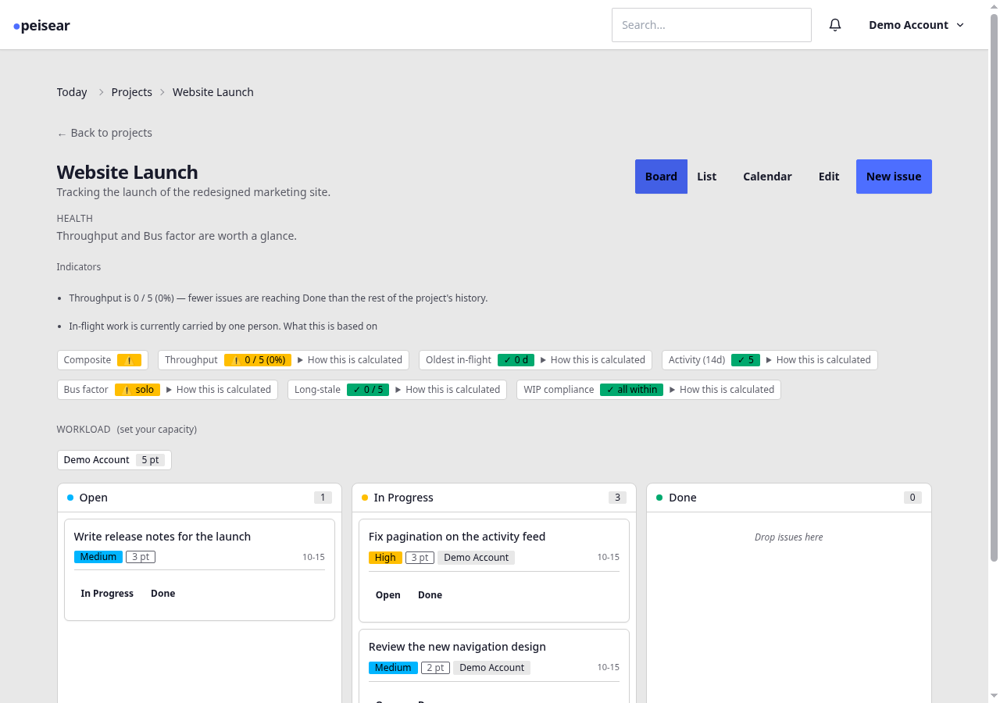
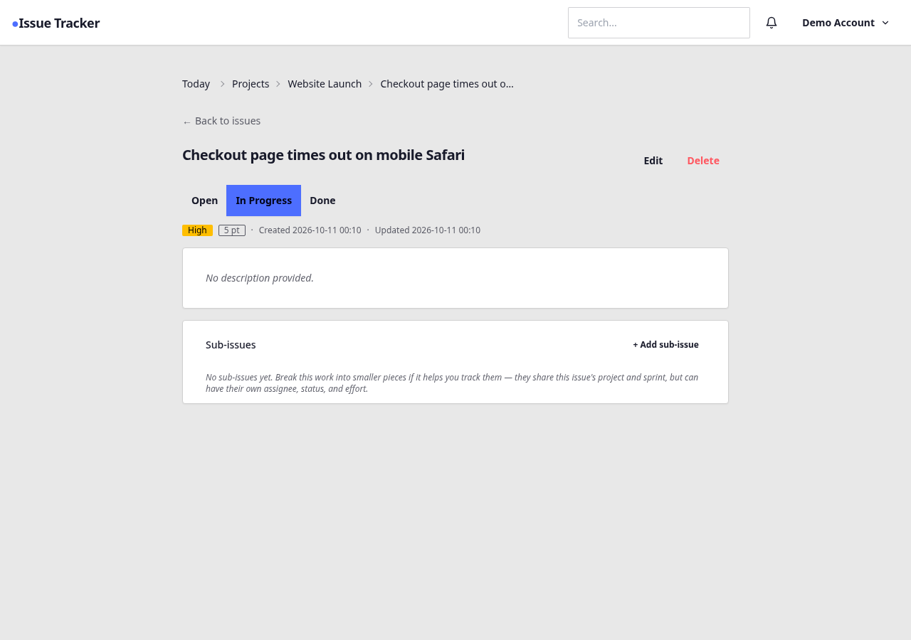
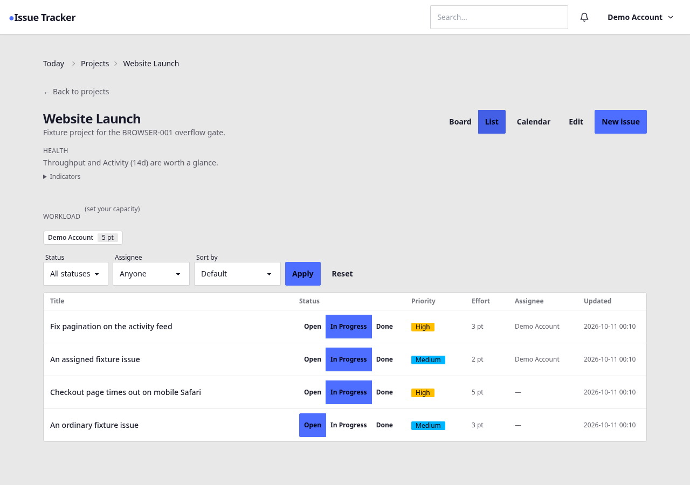
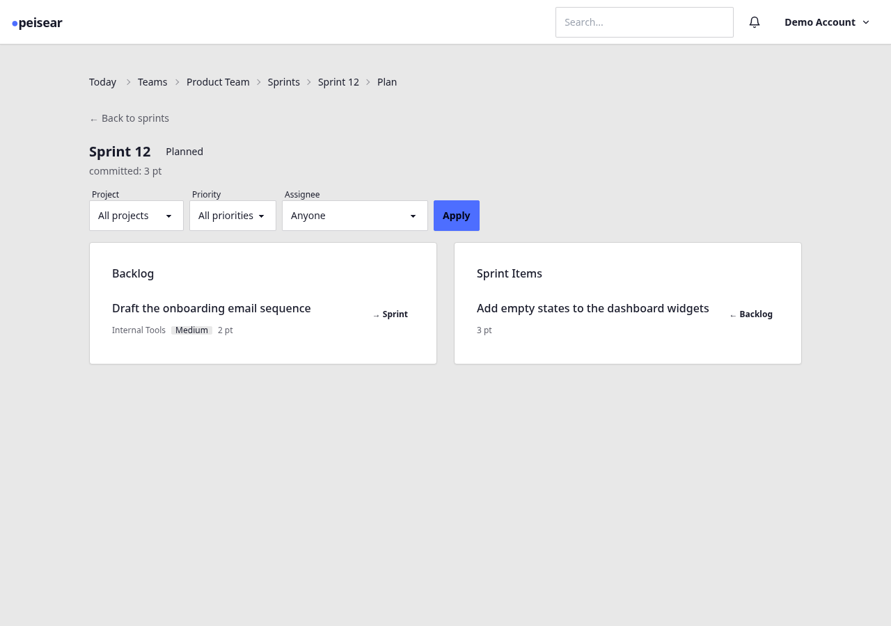

# First Run

With [Rust installed](installation.md) and a [`.env`](configuration.md)
in place, a working peisear instance is one command away.

## Launch

Run Cargo from the workspace root:

```bash
cargo run --release -p peisear
```

Or, because there's only one runnable binary in the workspace, the
shorthand works too:

```bash
cargo run --release
```

The first build compiles the full dependency graph (Leptos plus
axum plus sqlx is roughly 300 crates); expect ~10 minutes on a
cold cache. Subsequent runs are instant.

You should see:

```
2026-04-24T… INFO peisear: starting peisear database=sqlite://data/app.db addr=127.0.0.1:3000
2026-04-24T… INFO peisear: listening addr=127.0.0.1:3000
```

Open <http://localhost:3000>.

## First account

1. Click **Create one** on the login page to reach `/register`.
2. Fill in an email, display name, and a password of at least 8
   characters.
3. On submit you're redirected to `/projects` with an active session.

The SQLite database lives at `./data/app.db`. The parent directory is
auto-created on first run, and migrations execute before the server
starts accepting connections.

## First project, first issue

1. On `/projects` click **New project**. Name it, optionally describe
   it, submit.
2. You land on the project detail page in **Board** view. Click
   **New issue** to create one.

   
3. Submitting **New issue** takes you straight to that issue's own
   detail page — title, status, priority, effort, a description, and a
   place for sub-issues.

   
4. Back on the board, drag issue cards between the *Open* /
   *In Progress* / *Done* columns to change their status. The card
   moves immediately — the drag-and-drop uses a JSON POST to
   `/projects/{id}/issues/{issue_id}/status` in the background — and
   an undo affordance appears for five seconds in case you dragged the
   wrong card. The page only reloads if the server reports a conflict
   (someone else moved the same card first) or is unreachable.
5. Click **List** in the view toggle for a dense tabular view of every
   issue in the project, with filters for status, assignee, and sort
   order.

   

Open <http://localhost:3000/today> once you've assigned yourself an
issue or two. It's empty before that point — there's nothing personal
to show yet — but with even one assigned issue it has a WIP count and
a load figure, which is the one moment that page explains itself
rather than needing a tour.

## Planning a sprint

Sprints belong to teams, not to a single project — a team can pull
issues from any of its projects into one sprint.

1. On `/teams` click **New team**. Name it, submit; you land on the
   team's own detail page as its admin.
2. From there, create a project under the team (same **New project**
   form as before, now with the team pre-selected) and add an issue or
   two to it.
3. Click **Sprints**, then **New sprint**. Name it, set a start and
   end date, submit.
4. The sprint's **Plan** page is a two-column view: **Backlog** on the
   left (every open, top-level issue across the team's projects not
   already committed to an active sprint) and **Sprint Items** on the
   right. Move an issue between them with its row's own button, or by
   dragging it across.

   

## Health check

A trivial `/health` endpoint returns `200 ok` without authentication.
Use it for load balancers, uptime probes, and readiness gates:

```bash
curl -fsS http://localhost:3000/health
# ok
```

## Next

- [Architecture overview](../architecture/overview.md) — what you just ran
- [Deployment](../operations/deployment.md) — putting it on a real server
- [Security hardening](../security/hardening.md) — what's already protected
