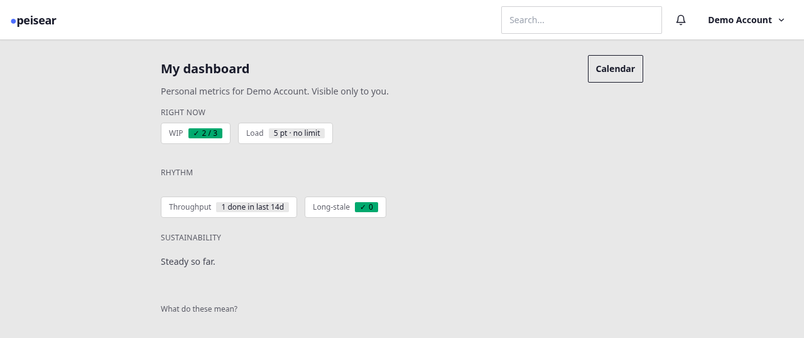

# Install

Three ways to get `peisear` running. Pick the one that fits — each
ends the same way, at the same URL.

## Option A: download a prebuilt binary

Every [GitHub Release](https://github.com/nabbisen/peisear/releases)
carries five archives, one per platform:

| Platform | Archive |
|---|---|
| Linux (x86_64) | `peisear-<version>-x86_64-unknown-linux-gnu.tar.gz` |
| Linux (arm64) | `peisear-<version>-aarch64-unknown-linux-gnu.tar.gz` |
| macOS (Apple Silicon) | `peisear-<version>-aarch64-apple-darwin.tar.gz` |
| macOS (Intel) | `peisear-<version>-x86_64-apple-darwin.tar.gz` |
| Windows (x86_64) | `peisear-<version>-x86_64-pc-windows-msvc.zip` |

Download the one that matches your machine, then extract it — the
archive's root holds the binary alone, no subdirectory to `cd` into:

```bash
tar xzf peisear-<version>-x86_64-unknown-linux-gnu.tar.gz
./peisear
#   → http://localhost:3000
```

(On Windows, extract the `.zip` and run `peisear.exe` from a terminal
in the same folder.)

## Option B: `docker run`

```bash
docker run -p 3000:3000 -v ./data:/data ghcr.io/nabbisen/peisear
#   → http://localhost:3000
```

`-v ./data:/data` is what makes the database and the generated signing
key survive a container restart — see
[Deployment](../operations/deployment.md) for the full picture,
including the working-directory note that applies to every shape, not
only this one.

## Option C: `cargo install`, if you already have Rust

```bash
cargo install peisear
peisear
#   → http://localhost:3000
```

This compiles from source via `crates.io` and installs into
`~/.cargo/bin/`. If you don't have a Rust toolchain yet, Option A or B
above gets you running without installing one — Option C is for
someone who already has `rustc` and `cargo` on hand, not a reason to
go get them. (If you want to read or change the code rather than just
run it, see [Build from source](build-from-source.md) instead — that
path clones the repository and builds from a checkout, which this one
does not.)

## What you'll see

Whichever path you took, the server starts with no configuration
required — `JWT_SECRET` is generated on first run and persisted beside
the database (see [Configuration](configuration.md) if you want to set
one yourself, or need to point at a different database). Register an
account, and you land on an empty project list:




The full walkthrough — creating a project, planning a sprint, dragging
cards between columns — is in [First run](first-run.md).

## Next

[Configuration](configuration.md) to set up `JWT_SECRET`, `BIND_ADDR`,
or a different database path, if the defaults above aren't what you
want; then [First run](first-run.md) for the full walkthrough.
